<picture>
  <source media="(prefers-color-scheme: dark)" srcset="./assets/banner-dark.svg">
  <source media="(prefers-color-scheme: light)" srcset="./assets/banner-light.svg">
  
</picture>

  
  
  

## About

I'm a developer from Germany working where software engineering meets security. I build full-stack applications and security tooling, and I care about understanding how systems behave under the hood — from network protocols down to bytecode interpreters.

- **Currently building** JoCaptcha, a captcha service written from scratch
- **Interested in** reverse engineering, virtual machines and client-side protection
- **Principle:** all security work is done responsibly and only with proper authorization

## Focus

| Area | Work |
| :--- | :--- |
| **Reverse Engineering** | VM analysis, disassembly, understanding obfuscated code |
| **VM Engineering** | Custom JavaScript runtimes, bytecode design, interpreters |
| **Network Security** | Traffic analysis, protocol inspection |
| **Penetration Testing** | Reconnaissance, vulnerability research |
| **Full-Stack Development** | Frontend, backend and API design |
| **Automation** | Python tooling, scripts and bots |

## Tech Stack

| | |
| :--- | :--- |
| **Languages** |    |
| **Frontend** |    |
| **Backend** |    |
| **Security** |    |
| **Tooling** |   |

## Projects

| Project | Status | Description |
| :--- | :--- | :--- |
| **JoVm** | `private` | Custom JavaScript virtual machine for captcha analysis, with its own bytecode format, interpreter and execution engine. |
| **JoCaptcha** | `in development` | Captcha system built from the ground up: custom challenge logic, full backend and API integration. Goal: a production-ready, tamper-resistant service. |

Public work is available in my [repositories](https://github.com/pushjoman21?tab=repositories).

## Contact

Open to freelance projects, security research collaborations and interesting ideas.
The fastest way to reach me is Discord: **`.joman21.`**
